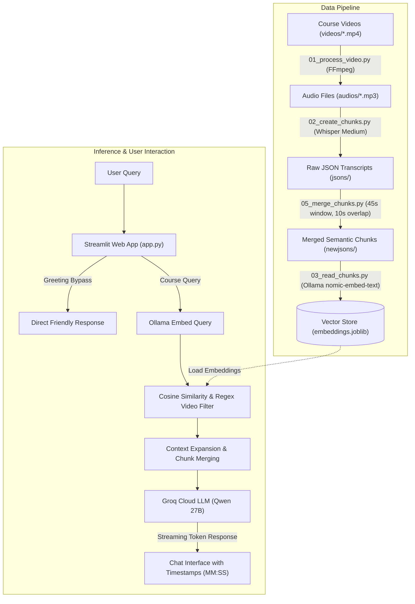

# 🎓 Sigma Web Dev AI Assistant — Video RAG System

An intelligent, multi-modal **Retrieval-Augmented Generation (RAG)** Teaching Assistant designed for the **Sigma Web Development Course**. 

The assistant enables students to ask technical questions in natural language, receives simple conceptual explanations with code snippets, and gets directed to the **exact video title, video number, and timestamp (`MM:SS`)** where the concept is taught.

---

## 🌟 Key Features

- **Multilingual Speech Translation:** Ingests raw video lectures in Hindi and automatically transcribes & translates them into English using OpenAI's **Whisper** model.
- **Context-Aware Sliding Window Chunking:** Dynamically groups transcript segments into 45-second target windows with a 10-second overlap to eliminate abrupt sentence cuts.
- **Dense Vector Search:** High-dimensional semantic embeddings generated using Ollama's `nomic-embed-text` model and stored in an indexed vector repository.
- **Targeted Video Filtering:** Automatically detects video numbers from user queries (e.g., *"What is covered in video 15?"*) to restrict or expand search scope.
- **Advanced Context Expansion:** Expands retrieved chunks ($\pm 1$ adjacent chunk) and merges consecutive segments from the same video for complete instructional context.
- **Low-Latency Streaming Inference:** Delivers real-time answers using **Qwen 27B** via **Groq Cloud API**.
- **Interactive Streamlit Web UI:** Clean, intuitive chat interface featuring session history and a conversational bypass for instant greeting replies.

---

## 🏗️ System Architecture



---

## 📂 Project Structure

```text
├── 01_process_video.py    # Extracts audio from video files using FFmpeg
├── 02_create_chunks.py     # Transcribes & translates Hindi audio to English via Whisper
├── 05_merge_chunks.py     # Merges raw segments into 45s sliding windows with overlap
├── 03_read_chunks.py      # Generates embeddings via Ollama and saves to embeddings.joblib
├── 04_process_incoming.py # Standalone CLI / test script for local inference
├── app.py                 # Streamlit web application with Groq LLM streaming
├── requirements.txt       # Core project dependencies
├── .gitignore             # Excludes heavy video/audio media files from Git
└── embeddings.joblib      # Precomputed vector embeddings and chunk metadata
```

---

## 🚀 Getting Started

### Prerequisites

1. **Python 3.10+** installed on your system.
2. **[Ollama](https://ollama.ai/)** installed and running locally for embeddings:
   ```bash
   ollama pull nomic-embed-text
   ```
3. *(Optional for local CLI testing)* If running `04_process_incoming.py` locally with Ollama:
   ```bash
   ollama pull llama3.2
   ```
4. A free **[Groq Cloud API Key](https://console.groq.com/)** for fast LLM streaming in the web interface.

---

### Installation

1. **Clone the repository:**
   ```bash
   git clone https://github.com/<your-username>/<your-repo-name>.git
   cd <your-repo-name>
   ```

2. **Create and activate a virtual environment (recommended):**
   ```bash
   # Windows
   python -m venv venv
   venv\Scripts\activate

   # macOS / Linux
   python3 -m venv venv
   source venv/bin/activate
   ```

3. **Install dependencies:**
   ```bash
   pip install -r requirements.txt
   ```

---

### Configuration

Open [app.py](file:///d:/Projects/rag%20based-ai/app.py) and paste your Groq API Key on line 20:

```python
GROQ_API_KEY = "your_actual_groq_api_key_here"
```

*(Best practice: You can also configure this using Streamlit secrets in `.streamlit/secrets.toml`)*

---

### Running the Web Application

Ensure **Ollama** is running in the background, then launch Streamlit:

```bash
streamlit run app.py
```

Open your browser at `http://localhost:8501` to start chatting with the AI Teaching Assistant!

---

## 🛠️ Data Pipeline Execution (Optional)

If you wish to re-process new course videos from scratch:

1. Place `.mp4` video files in `videos/` folder.
2. Run audio extraction:
   ```bash
   python 01_process_video.py
   ```
3. Run Whisper transcription & translation:
   ```bash
   python 02_create_chunks.py
   ```
4. Merge transcript segments into sliding windows:
   ```bash
   python 05_merge_chunks.py
   ```
5. Generate embeddings and vector store:
   ```bash
   python 03_read_chunks.py
   ```

---

## 🧰 Tech Stack

- **Frontend / Framework:** [Streamlit](https://streamlit.io/)
- **Large Language Model:** [Qwen 2.5 / 3.8 via Groq Cloud API](https://groq.com/)
- **Embedding Model:** `nomic-embed-text` via [Ollama](https://ollama.ai/)
- **Speech-to-Text & Translation:** [OpenAI Whisper](https://github.com/openai/whisper)
- **Audio Processing:** [FFmpeg](https://ffmpeg.org/)
- **Vector Math & Similarity:** [scikit-learn](https://scikit-learn.org/), [NumPy](https://numpy.org/), [Pandas](https://pandas.pydata.org/)
- **Serialization:** [Joblib](https://joblib.readthedocs.io/)
